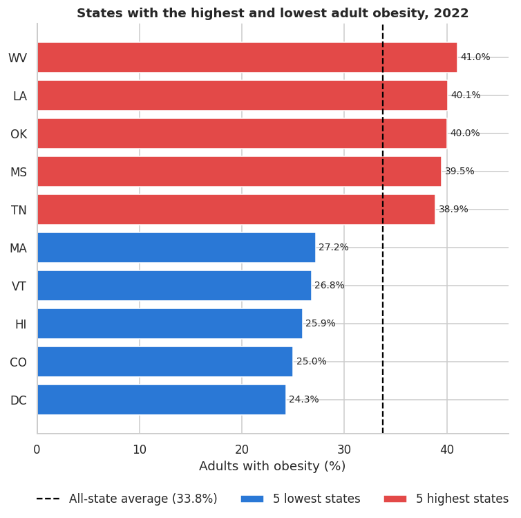
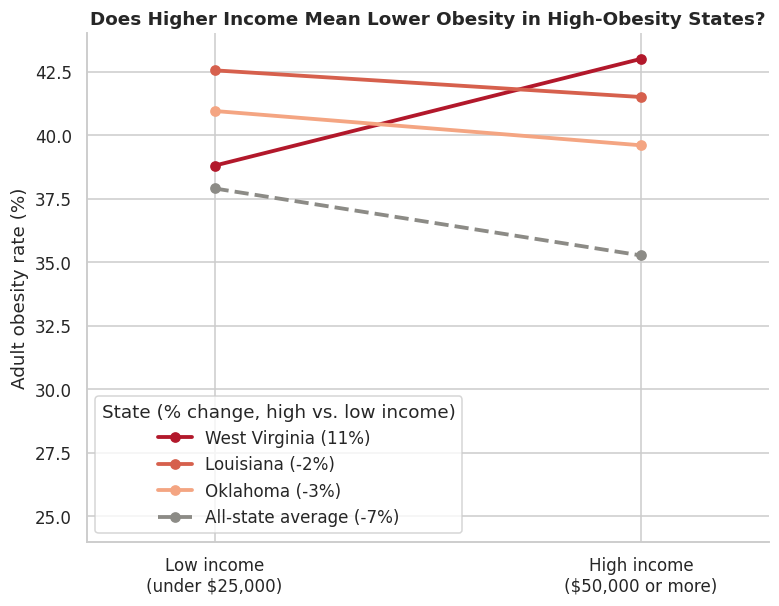
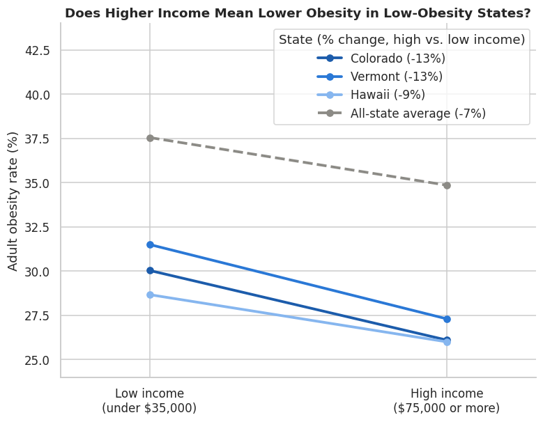
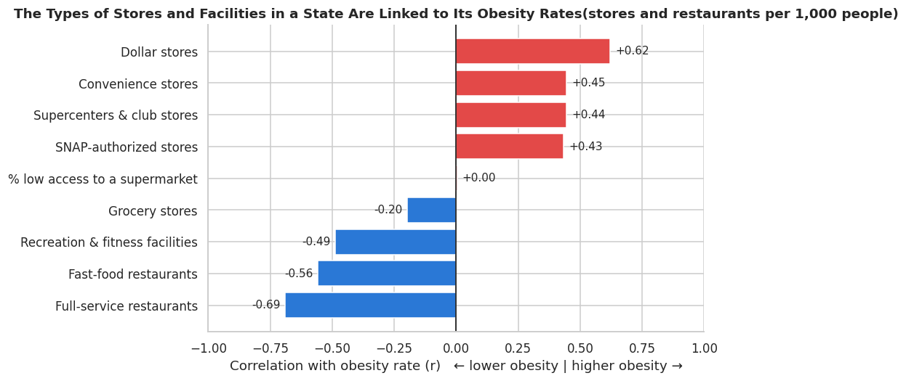
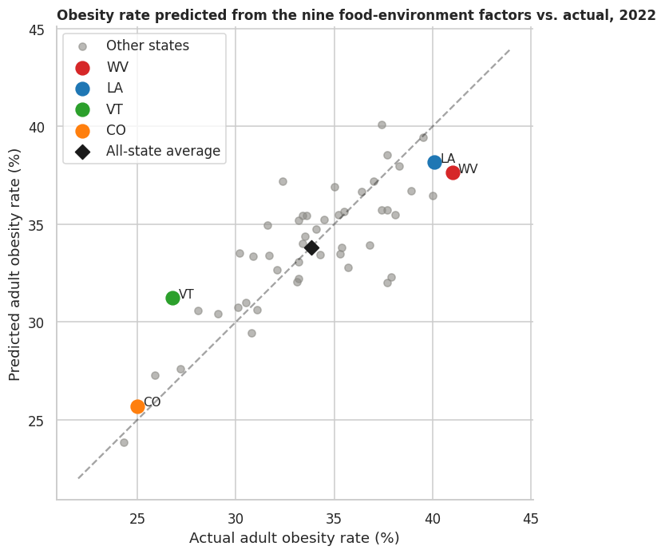

# Where You Live Matters: U.S. Obesity and the Food Environment


[](https://colab.research.google.com/github/SanjayKumar84/B09-Obesity-and-Food-Environment-Analysis/blob/main/B09_Obesity_and_Food_Enivornment_Analysis.ipynb)

**BA780 Introduction to Data Analytics · Boston University Questrom School of Business · MSBA · Team B09 · Fall 2026**

> **TL;DR:** We joined CDC obesity survey data with the USDA Food Environment Atlas for all 50 states and DC. A state's income is the strongest predictor of its obesity rate (r = −0.71), but income alone doesn't explain the gap. People in the same income bracket still have very different obesity rates depending on their state. The mix of stores, restaurants and recreation facilities explains about 69% of the variation between states.

---

## The business question

Adult obesity in the U.S. ranges from **24% to 41% depending on the state**. A state public-health department has a limited budget for programs like SNAP incentives, healthy-store programs and community recreation, so it has to choose:

> **Which states should get prevention programs first, and which programs fit each place?**

**Audience:** state and regional public-health departments (chronic disease and nutrition divisions). Secondary stakeholders are funders (CDC, USDA), county health offices and community organizations.

---

## Key findings

### 1. Where you live makes a big difference
Obesity rose from **27.4% (2011) to 33.1% (2024)** nationally. In 2022, West Virginia was at **41.0%** and DC at **24.3%**. **22 states** were at 35% or higher, mostly in the South and Appalachia.



### 2. Income matters, but it doesn't explain the gap
Wealthier states have lower obesity (**r = −0.71**). But when we compare people **in the same income bracket**, obesity still differs a lot by state. In low-obesity states, higher earners have much lower obesity. In high-obesity states, they barely do better, and in West Virginia they actually do worse.

<p>
  
  
</p>

### 3. The food environment tells the rest of the story
States with more **dollar stores** per person have higher obesity (**r = +0.62**). States with more **full-service restaurants** (**r = −0.69**) and **recreation and fitness facilities** (**r = −0.49**) have lower obesity.



### 4. Nine food-environment factors explain most of the gap between states
A simple linear regression on nine store, restaurant and facility measures explains about **69% of the variation** in state obesity (R² = 0.69). The states it misses point to factors outside our data, such as walkability, transit and food prices.



### What this means for a health department
- **Start with the highest-obesity states.** In those states, even college graduates, young adults and higher earners are above the all-state average, so programs should reach **whole communities**, not just low-income households.
- **Combine affordable healthy food with places to be active.** A single program alone is unlikely to work, since the high-obesity states fall short on almost every food-environment measure at once.
- **Focus on high-risk groups.** Low food access among American Indian/Alaska Native residents, children and SNAP households was linked to higher obesity.

> All relationships are **state-level correlations, not proof of cause and effect.**

---

## Data

| Dataset | Source | Raw size | What we used |
|---|---|---|---|
| BRFSS Nutrition, Physical Activity & Obesity (2011–2024) | [CDC via data.gov](https://catalog.data.gov/dataset/nutrition-physical-activity-and-obesity-behavioral-risk-factor-surveillance-system) | 110,880 rows × 33 cols | Obesity, activity and diet indicators by state, year, income, education, age, sex and race |
| Food Environment Atlas (2025) | [USDA ERS](https://ers.usda.gov/data-products/food-environment-atlas/data-access-and-documentation-downloads) | 957,753 rows, 304 variables, 3,156 counties | Store, restaurant, access, health and socioeconomic indicators |

## Approach

```
BRFSS (state × year × group)      Food Environment Atlas (county, long format)
        │                                   │
 drop suppressed estimates          replace -9999 / -8888 placeholders with NaN
 short indicator labels             fix units mislabeled as "Count" (actually per 1,000)
 numeric sample sizes               keep 5 relevant categories
        │                           counties → states (sum counts, average rates)
        │                           long → wide (51 states × 111 variables)
        └──────────── merge on state ───────────┘
                          │
          EDA → correlations → state profiles → linear regression
```

**Cleaning highlights**
- **BRFSS:** 110,880 → 97,666 rows after removing 13,214 estimates suppressed for small sample sizes. No duplicates found.
- **Atlas:** converted 90,259 placeholder values (−9999 / −8888) to missing, so they wouldn't turn state averages negative.
- **Atlas:** found variables like `FSRPTH20` that the data dictionary labels as counts but are actually per-1,000 rates, and fixed them before aggregating.
- **Atlas:** rolled counties up to states by summing counts and averaging rates, then reshaped to one row per state.
- **Merge:** many-to-one join on state code. Territories and the national row were dropped, leaving 51 matched states.

## My contribution
I cleaned the **USDA Food Environment Atlas** for the team. That meant handling the placeholder codes, fixing the mislabeled units, and preparing the county-level data for the state-level roll-up. The roll-up let us join the Atlas with the CDC data and got our dataset approved.

## Limitations
- **Correlation, not causation.** Income, urbanization and age are tangled together at the state level.
- **Unweighted averages.** County values were averaged without population weights, and some variables (supercenters, specialty stores, fitness facilities) are missing for many counties.
- **Mismatched years.** BRFSS and Atlas variables cover different years (2021–2024).
- **Small sample for the model.** The R² is in-sample, with 51 states and 9 predictors, so it overstates how well the model would predict new data.
- **Self-reported data.** BRFSS height and weight are self-reported, which tends to understate obesity.

## Next steps
- Add county-level obesity estimates (e.g., CDC PLACES) for a finer-grained match with the Atlas.
- Weight county-to-state aggregation by population.
- Add walkability, transit, healthcare access and food price data to explain the states the model misses.
- Compare obesity trends before and after healthy-store or recreation programs to test cause and effect.

---

## Repository

```
├── B09_Obesity_and_Food_Enivornment_Analysis.ipynb   # full notebook: cleaning, analysis, charts, conclusions
├── images/                                           # charts exported from the notebook for this README
└── README.md
```

## How to run
1. Click **Open in Colab** above.
2. Download the two datasets linked in [Data](#data). Put `BRFSS_Obesity.csv`, `StateAndCountyData.csv` and `VariableList.csv` in `MyDrive/780-project/data/`.
3. Run all cells. The notebook mounts Google Drive automatically.

**Tools:** Python, pandas, NumPy, matplotlib, seaborn, scikit-learn, Google Colab

## Team B09
Bhavya Kandhari · Zoya Salman · Danyang (Lucy) Qin · **Sanjay Kumar** · Dylan Rubenstein

*The notebook includes a full generative-AI use disclosure.*
